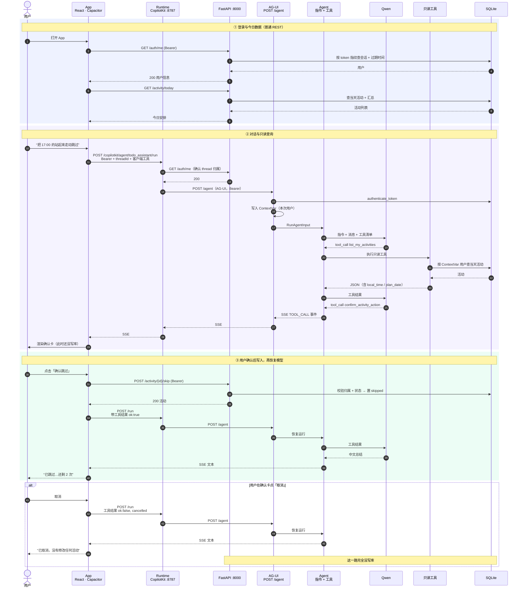

# 久坐活动助手 API 文档

> 覆盖当前 `main` 上的全部对外接口，包括 REST、Agent 对话（AG-UI）和前端确认卡协议。
> 交互细节以 `docs/api-day-5.md`、`docs/api-day-6.md` 为历史版本，本文为最新汇总。

- 后端：FastAPI，默认 `http://<host>:8000`
- 交互文档：`/docs`，机器可读定义：`/openapi.json`
- CopilotKit Runtime：默认 `http://<host>:8787/copilotkit`
- Agent 标识：`todo_assistant`（内部兼容名，产品已不再包含待办清单）
- 路由定义：`app/routers/auth.py`、`app/activity/router.py`、`app/daily_report/router.py`、`app/agent/endpoint.py`
- 模型定义：`app/schemas.py`、`app/activity/schemas.py`、`app/daily_report/schemas.py`

---

## 1. 交互时序



三条硬边界：

1. 所有写操作只有 REST 接口一条路，模型没有写数据库的能力。
2. Agent 的身份只来自 `Authorization`，工具参数和请求体里都没有 `user_id`。
3. 用户在确认卡上点确认之前，后端不会收到任何写请求。

---

## 2. 通用约定

### 2.1 认证

- 登录成功后返回不透明 `access_token`，请求头携带 `Authorization: Bearer <token>`。
- 服务端只保存 token 的 SHA-256 指纹，有效期 120 分钟；退出登录立即删除会话。
- 缺失、伪造、过期、已退出的令牌统一返回 `401`，并带 `WWW-Authenticate: Bearer`。
- 路径、查询参数、请求体都不接受 `user_id`；访问别人的资源按 `404` 处理，不暴露是否存在。

### 2.2 时间与时区

- 数据库与接口里的时间都是 ISO 8601 字符串，带时区偏移（如 `2026-11-08T09:00:00+00:00`）。
- 业务时区固定为 `Asia/Shanghai`；`scheduled_at` 是存储值，展示应使用接口返回的 `local_time`（如 `17:00`）。
- 日期字段统一 `YYYY-MM-DD`，周统计以周一为一周起点。

### 2.3 错误结构

参数校验失败统一返回 `422`：

```json
{
  "detail": "请求参数校验失败",
  "errors": [
    { "field": "password", "message": "String should have at least 6 characters", "type": "string_too_short" }
  ]
}
```

业务错误返回 `{ "detail": "中文提示" }`，前端可直接展示。

| 状态码 | 含义 | 典型场景 |
|---|---|---|
| 400 | 请求不合法 | 验证码未获取、已过期 |
| 401 | 未登录 / 凭证无效 | 缺失 token、token 过期、已退出 |
| 404 | 资源不存在或不属于当前用户 | 操作别人的活动、模板 |
| 409 | 状态冲突 | 活动已完成/已跳过、手机号已注册 |
| 422 | 参数或业务校验失败 | 时间格式、窗口、免打扰、冲突、未来周 |
| 429 | 频率限制 | 验证码发送过快、错误次数过多 |
| 503 | 依赖不可用 | Redis 队列不可用（日报） |

### 2.4 幂等与状态机

- `POST /activity/generate` 幂等：同一天重复调用返回同一批活动，`already_generated=true`。
- 活动状态：`planned` → `completed` / `skipped` / `postponed`。
- 推迟不修改原记录，而是「原记录置 `postponed` + 派生一条新 `planned`」，用 `postponed_from_id` 关联。
- `complete` / `skip` / `postpone` 只接受 `planned` 状态，其他状态返回 `409`。
- 未完成统计只数 `planned`；`postponed` 是已改期的旧记录，不重复计入。

---

## 3. 接口总览

| 分组 | 方法与路径 | 鉴权 | 说明 |
|---|---|---|---|
| 运维 | `GET /health` | 否 | 容器健康检查 |
| 认证 | `POST /auth/sms/send` | 否 | 发送手机验证码 |
| 认证 | `POST /auth/register` | 否 | 手机号注册并登录 |
| 认证 | `POST /auth/login` | 否 | 账号或手机号登录 |
| 认证 | `GET /auth/me` | 是 | 当前用户 |
| 认证 | `POST /auth/logout` | 是 | 退出并删除会话 |
| 设置 | `GET /activity/settings` | 是 | 读取活动设置 |
| 设置 | `PUT /activity/settings` | 是 | 全量保存活动设置 |
| 今日 | `GET /activity/today` | 是 | 今日安排 + 汇总 |
| 今日 | `POST /activity/generate` | 是 | 生成当天安排（幂等） |
| 模板 | `GET /activity/templates` | 是 | 模板列表 |
| 模板 | `POST /activity/templates` | 是 | 新建模板 |
| 模板 | `PUT /activity/templates/{id}` | 是 | 编辑模板 |
| 模板 | `POST /activity/templates/{id}/archive` | 是 | 归档模板 |
| 模板 | `POST /activity/templates/{id}/schedule` | 是 | 把模板加入某天 |
| 流转 | `POST /activity/{id}/complete` | 是 | 完成 |
| 流转 | `POST /activity/{id}/skip` | 是 | 跳过（可带原因） |
| 流转 | `GET /activity/{id}/postpone-options` | 是 | 可推迟的候选时间 |
| 流转 | `POST /activity/{id}/postpone` | 是 | 推迟（指定或自动找槽） |
| 统计 | `GET /activity/week` | 是 | 周度复盘 |
| Agent | `POST /activity/agent/suggest` | 是 | 预排候选（只读） |
| Agent | `POST /activity/agent/confirm` | 是 | 确认并保存候选 |
| 日报 | `GET /reports/{report_date}` | 是 | 查询某天日报 |
| 日报 | `POST /reports/{report_date}/generate` | 是 | 手动生成/补跑 |
| Agent | `POST /agent` | 是 | AG-UI SSE 对话入口 |
| Runtime | `/copilotkit/*` | 是 | 浏览器与 Agent 之间的转发层 |

---

## 4. 运维

### GET /health

无需登录。用于容器健康检查。

```json
{ "status": "ok", "app": "久坐活动助手 API", "version": "1.0.0", "time": "2026-11-08T10:08:31+00:00" }
```

---

## 5. 认证

### 5.1 POST /auth/sms/send

请求：

```json
{ "phone": "13800138000" }
```

响应：

```json
{
  "expires_in": 300,
  "resend_after": 60,
  "debug_code": "123456",
  "masked_phone": "138****8000"
}
```

- `debug_code` 仅在练习环境（`SMS_DEBUG_RETURN_CODE=true`）返回，生产为 `null`。
- `429`：60 秒内重复发送，或当日次数超限。

### 5.2 POST /auth/register

请求：

```json
{ "phone": "13800138000", "code": "123456", "password": "secret123", "display_name": "练习同学" }
```

响应同登录（`200`）。`409` 表示手机号已注册；验证码错误返回 `400/429`。

### 5.3 POST /auth/login

`username` 同时接受账号或注册手机号。

```json
{ "username": "intern", "password": "intern123456" }
```

响应：

```json
{
  "access_token": "opaque-token",
  "token_type": "bearer",
  "expires_at": "2026-11-08T12:08:31+00:00"
}
```

`401` 统一提示「账号或密码不正确」，不区分账号是否存在。

### 5.4 GET /auth/me

```json
{ "id": 1, "username": "intern", "phone": null, "display_name": "练习同学", "created_at": "2026-11-01T02:00:00+00:00" }
```

### 5.5 POST /auth/logout

成功返回 `204`，服务端删除当前会话；旧令牌立即失效。

---

## 6. 活动设置

### GET /activity/settings

```json
{
  "work_start": "09:00",
  "work_end": "18:00",
  "morning_start": "10:00",
  "morning_end": "12:00",
  "afternoon_start": "14:00",
  "afternoon_end": "17:30",
  "daily_target": 3,
  "reminders_enabled": true,
  "allow_in_worktime": true,
  "postpone_policy": "next_slot",
  "timezone": "Asia/Shanghai",
  "quiet_periods": [
    { "id": 1, "start_time": "12:00", "end_time": "14:00", "label": "午休", "enabled": true }
  ]
}
```

### PUT /activity/settings

请求体与响应的可写字段一致（无 `id`、`timezone`）：

```json
{
  "work_start": "09:00",
  "work_end": "18:00",
  "morning_start": "10:00",
  "morning_end": "12:00",
  "afternoon_start": "14:00",
  "afternoon_end": "17:30",
  "daily_target": 3,
  "reminders_enabled": true,
  "allow_in_worktime": true,
  "postpone_policy": "next_slot",
  "quiet_periods": [{ "start_time": "12:00", "end_time": "14:00", "label": "午休", "enabled": true }]
}
```

- `daily_target` 取值 1–8；时间为 `HH:MM`。
- 校验失败（窗口越界、免打扰与工作时段冲突等）返回 `422`。
- 免打扰列表为全量替换。

---

## 7. 今日安排与生成

### GET /activity/today

返回的 `activities` 按真实时刻升序排列；库里同时存在 `+08:00` 与 `+00:00` 的时间串时也不会错位。

```json
{
  "date": "2026-11-08",
  "summary": { "total": 7, "planned": 3, "completed": 2, "postponed": 1, "skipped": 1 },
  "activities": [
    {
      "id": 102,
      "activity_type": "walk",
      "title": "站起来走动",
      "description": "离开座位走动一会儿，活动活动腿脚，再回来继续工作。",
      "plan_date": "2026-11-08",
      "scheduled_at": "2026-11-08T09:00:00+00:00",
      "duration_minutes": 5,
      "status": "planned",
      "source": "system",
      "postponed_from_id": null,
      "skipped_reason": null,
      "completed_at": null
    }
  ]
}
```

### POST /activity/generate

无请求体。响应：

```json
{
  "already_generated": false,
  "requested": 3,
  "planned": 3,
  "notice": null,
  "activities": ["...ActivityOut..."]
}
```

- 同一天重复调用返回已有活动，`already_generated=true`。
- 安排会避开免打扰、工作时段外与已占用时间。

---

## 8. 模板

### GET /activity/templates?include_archived=false

返回 `TemplateOut[]`：

```json
[
  {
    "id": 3,
    "name": "喝水休息",
    "description": "起身接水，顺便活动肩颈",
    "duration_minutes": 5,
    "archived": false,
    "archived_at": null,
    "created_at": "2026-11-05T02:00:00+00:00",
    "updated_at": "2026-11-05T02:00:00+00:00"
  }
]
```

### POST /activity/templates

```json
{ "name": "喝水休息", "description": "起身接水，顺便活动肩颈", "duration_minutes": 5 }
```

`name` / `description` 不能只有空格；时长范围见服务端常量。

### PUT /activity/templates/{id}

请求体同新建；`404` 表示模板不存在或不属于当前用户。

### POST /activity/templates/{id}/archive

归档后默认列表不再返回，传 `include_archived=true` 可查。

### POST /activity/templates/{id}/schedule

```json
{ "plan_date": "2026-11-08", "time": "16:00", "duration_minutes": 5 }
```

返回新建的 `ActivityOut`。`422` 表示时间不可用或与现有安排冲突。

---

## 9. 活动状态流转

### 9.1 POST /activity/{id}/complete

无请求体，返回 `ActivityOut`。非 `planned` 状态返回 `409`。

### 9.2 POST /activity/{id}/skip

```json
{ "reason": "下午开会" }
```

请求体必传；没有原因时传 `{}`。`reason` 最长 120 字，返回 `ActivityOut`。

### 9.3 GET /activity/{id}/postpone-options

```json
{ "plan_date": "2026-11-08", "times": ["16:05", "16:35", "17:05"] }
```

- 30 分钟粒度，避开免打扰与已占用。
- 起点取「原活动时间 + 间隔」和「当前时间 + 间隔」中较晚的一个，不会给出已经过去的时段。

### 9.4 POST /activity/{id}/postpone

body 可为空对象 `{}`（自动找下一个可用槽），或指定北京时间：

```json
{ "scheduled_at": "2026-11-08T17:30:00+08:00" }
```

响应：

```json
{ "ok": true, "activity": { "...派生的新 ActivityOut..." } }
```

- 原记录置 `postponed`，新记录 `planned` 且 `postponed_from_id` 指向原记录。
- 指定时间必须与原活动同一天，且通过工作时段、免打扰、冲突校验，否则 `422`。
- 当天没有可用槽时返回 `200` 且 `{ "ok": false, "reason": "今日剩余时段不足，无法再推迟" }`。
- 非 `planned` 状态返回 `409`。

---

## 10. 周统计

### GET /activity/week?week_start=2026-11-02&timezone=Asia/Shanghai

- `week_start` 可省略，默认当前周；必须是周一，且不能是未来周，否则 `422`。
- `timezone` 默认 `Asia/Shanghai`。

```json
{
  "week_start": "2026-11-02",
  "week_end": "2026-11-08",
  "timezone": "Asia/Shanghai",
  "is_current": true,
  "is_complete": false,
  "planned": 17,
  "completed": 8,
  "skipped": 6,
  "pending": 3,
  "denominator": 17,
  "completion_rate": 0.47,
  "postponed_activities": 3,
  "postponed_ops": 3,
  "generated_at": "2026-11-08T10:26:00+00:00",
  "days": [
    {
      "date": "2026-11-02",
      "planned": 3,
      "completed": 2,
      "skipped": 0,
      "pending": 1,
      "denominator": 3,
      "completion_rate": 0.67,
      "has_activities": true,
      "activities": [
        {
          "id": 102,
          "title": "站起来走动",
          "scheduled_at": "2026-11-08T09:00:00+00:00",
          "local_time": "17:00",
          "status": "planned",
          "source": "system",
          "duration_minutes": 5,
          "is_postponed": false
        }
      ]
    }
  ]
}
```

- `planned` 已排除推迟链上的中间记录（`status=postponed`），`denominator = planned`，`completion_rate = completed / denominator`。
- `postponed_activities` 与 `postponed_ops` 是不同维度，不能相加。

---

## 11. Agent 预排接口

### POST /activity/agent/suggest?daily_target=3&from_time=14:00

只读、不落库。

```json
{
  "requested": 3,
  "planned": 3,
  "slots": [
    { "scheduled_at": "2026-11-08T06:55:00+00:00", "activity_type": "walk", "title": "站起来走动" }
  ],
  "notice": null
}
```

`daily_target` 取值 1–8；`from_time` 为 `HH:MM`，只考虑此后的时段。

### POST /activity/agent/confirm

```json
{
  "slots": [
    { "scheduled_at": "2026-11-08T06:55:00+00:00", "activity_type": "walk", "title": "站起来走动" }
  ]
}
```

响应：

```json
{ "planned": 1, "activities": ["...ActivityOut..."] }
```

- `slots` 不能为空。
- 后端会再次校验工作时段、免打扰与冲突，不信任前端传来的时间。

---

## 12. 日报

### GET /reports/{report_date}

`report_date` 必须是已经结束的自然日，且不超过一年，否则 `422`。

```json
{
  "report_date": "2026-11-07",
  "status": "success",
  "stats": {
    "planned": 3,
    "completed": 2,
    "skipped": 1,
    "uncompleted": 0,
    "postponed_ops": 1
  },
  "review": "今天完成了两次活动……",
  "suggestion": "明天可以把下午的活动提前一点……",
  "sedentary": { "recorded": false, "minutes": null },
  "generated_at": "2026-11-08T00:10:00+08:00",
  "attempt": 1,
  "error": null
}
```

`status` 取值：`not_generated`、`pending`、`running`、`success`、`failed`。

### POST /reports/{report_date}/generate

`202` 表示已入队：

```json
{ "report_date": "2026-11-07", "status": "queued", "job_id": "daily-report:1:2026-11-07", "message": "..." }
```

- `200 + already_generated`：已有成功结果，直接复用。
- `200 + in_progress`：正在生成或已在队列中。
- `503`：Redis 不可用，任务未提交。

---

## 13. Agent 对话

### 13.1 POST /agent（AG-UI）

- 请求体是 AG-UI `RunAgentInput`，响应是 SSE 事件流。
- 鉴权发生在建流之前：未登录/过期返回普通 JSON `401`，不会建立事件流。
- 仅在配置了 `QWEN_API_KEY` 时注册；否则 `/agent` 不存在，其余接口正常。
- 鉴权通过后，用户写入 `ContextVar`，工具执行时只按这个身份取数。

### 13.2 Runtime 转发层

浏览器不直接访问 `/agent`，而是访问 CopilotKit Runtime：

| 方法与路径 | 说明 |
|---|---|
| `GET /health` | Runtime 进程健康检查，无需鉴权 |
| `GET /copilotkit/info` | Runtime 与 Agent 能力探测 |
| `POST /copilotkit/agent/{agentId}/connect` | 建立会话 |
| `POST /copilotkit/agent/{agentId}/run` | 发起/恢复一次运行，SSE 返回 |
| `POST /copilotkit/agent/{agentId}/stop` | 中止当前运行 |
| `GET /copilotkit/threads` | 当前用户的会话列表 |
| `GET /copilotkit/threads/{id}/messages` | 会话消息 |
| `GET /copilotkit/threads/{id}/events` | AG-UI 事件 |
| `GET /copilotkit/threads/{id}/state` | 会话快照 |
| `POST /copilotkit/threads/clear` | 清空当前用户的会话 |

- Runtime 会转发本次请求的 `Authorization`，并调用后端 `/auth/me` 确认 thread 归属；不同用户复用同一 `threadId` 会被拒绝。
- 对话历史保存在 Runtime 进程内存，Runtime 重启后丢失。

### 13.3 前端确认卡（客户端工具）

这两个工具由前端注册，模型只能发起调用，不能直接写库。

**confirm_schedule**

```json
{
  "slots": [
    { "scheduled_at": "2026-11-08T10:55:00+00:00", "activity_type": "walk", "title": "站起来走动" }
  ]
}
```

用户确认后，前端调用 `POST /activity/agent/confirm`，再把结果回传模型：

```json
{ "ok": true, "planned": 3 }
```

取消：`{ "ok": false, "cancelled": true }`；失败：`{ "ok": false, "message": "..." }`。

**confirm_activity_action**

```json
{
  "action": "skip",
  "activity_id": 102,
  "title": "站起来走动",
  "local_time": "17:00",
  "plan_date": "2026-11-08",
  "target_time": "17:30",
  "reason": "下午开会"
}
```

- `action`：`complete` / `skip` / `postpone`
- `activity_id`、`title`、`local_time`、`plan_date` 必须原样取自 `list_my_activities`
- `target_time` 仅推迟时使用，`HH:MM`，可省略
- 确认后前端调用对应的 `complete` / `skip` / `postpone` 接口，再回传 `{ "ok": true }` 或 `{ "ok": true, "new_local_time": "17:30" }`

### 13.4 只读工具返回结构

**get_my_activity_settings**：同 `ActivitySettingsOut`。

**list_my_activities**

```json
{
  "date": "2026-11-08",
  "timezone": "Asia/Shanghai",
  "summary": { "total": 3, "planned": 1, "completed": 2, "postponed": 1, "skipped": 0 },
  "activities": [
    {
      "id": 102,
      "title": "站起来走动",
      "plan_date": "2026-11-08",
      "local_time": "17:00",
      "scheduled_at": "2026-11-08T09:00:00+00:00",
      "status": "planned",
      "source": "system",
      "postponed_from_id": null
    }
  ]
}
```

**preview_schedule(daily_target, from_time)**

```json
{
  "requested": 3,
  "planned": 3,
  "slots": [
    { "scheduled_at": "2026-11-08T06:55:00+00:00", "local_time": "14:55", "activity_type": "walk", "title": "站起来走动" }
  ],
  "notice": null,
  "quiet_periods": ["12:00-14:00"]
}
```

---

## 14. 调用示例

```bash
# 1. 登录并保存 token
TOKEN=$(curl -s -X POST http://localhost:8000/auth/login \
  -H "Content-Type: application/json" \
  -d '{"username":"intern","password":"intern123456"}' | jq -r .access_token)

# 2. 今日安排
curl -s http://localhost:8000/activity/today -H "Authorization: Bearer $TOKEN" | jq

# 3. 生成当天安排（幂等）
curl -s -X POST http://localhost:8000/activity/generate -H "Authorization: Bearer $TOKEN" | jq

# 4. 完成一条活动
curl -s -X POST http://localhost:8000/activity/102/complete -H "Authorization: Bearer $TOKEN" | jq

# 5. 推迟到指定时间
curl -s -X POST http://localhost:8000/activity/103/postpone \
  -H "Authorization: Bearer $TOKEN" -H "Content-Type: application/json" \
  -d '{"scheduled_at":"2026-11-08T17:30:00+08:00"}' | jq

# 6. 周统计
curl -s "http://localhost:8000/activity/week?week_start=2026-11-02" \
  -H "Authorization: Bearer $TOKEN" | jq

# 7. 昨天日报
curl -s http://localhost:8000/reports/2026-11-07 -H "Authorization: Bearer $TOKEN" | jq
```

---

## 15. 已知边界

- 单机 SQLite + 同步 service；多实例部署需要换成 Postgres 并调整调度与连接管理。
- 没有 `/v1` 版本前缀，破坏性变更需要通过新增路径过渡。
- token 存浏览器 `localStorage`，没有 refresh token；2 小时到期需重新登录。
- Agent 会话历史存在 Runtime 内存，进程重启会丢失；业务数据仍在数据库里。
- 日报生成依赖 Redis + ARQ worker；队列不可用时返回 `503`，不会留下假的 pending 记录。
- 真机包的后端地址在构建时写入局域网 IP，换网段需要重打 APK。
